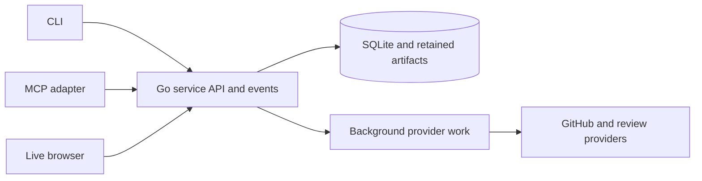

# FireController

[](LICENSE)
[](docs/delivery.md)

FireController is self-hosted coordination infrastructure for AI workers and the people running their projects. It brings jobs, durable messaging, review orchestration, and a live browser together behind one service API.

AI workers are the primary clients. Everyday commands return concise, useful information promptly; jobs and messages work independently of GitHub availability. The service owns provider refresh and long-running reviews so each command does not repeat that work.

## Current status

The standalone application is under development. The merged [PR #1](https://github.com/benhook1013/FireController/pull/1) contains the design and repository validation. [PR #2](https://github.com/benhook1013/FireController/pull/2) combines the first local CLI commands, `fc version` and `fc context`, private profile validation, and the durable coordination service. [PR #4](https://github.com/benhook1013/FireController/pull/4) brings together the agent clients, live message transport and embedded browser. [PR #7](https://github.com/benhook1013/FireController/pull/7) adds immutable job checkpoints and the native review workspace.

The coordination slice implements a loopback service API, scoped projects/workers and access grants, basic jobs with guarded edits/history, and durable message reads and explicit seen/ack actions. See the [local API](docs/local-api.md). An embedded browser displays jobs/checkpoints, workers, live incoming conversations and stored review queue/history/findings; open the service address and connect with a project credential. Explicit [coordination views](docs/browser-coordination.md) add notes and their revisions, worker pause and primary focus. Browser messaging and administrator appearance controls follow the connected credential’s permissions. The [browser guide](docs/browser-guide.md) describes current scope and proof. Optional native review execution and retained review controls are described in [review execution](docs/review-execution.md). Local [backups, managed scheduling, retention, inactive restore and coordination activation](docs/backups.md) have packaged proof. Local [profile creation and POSIX bound launchers](docs/onboarding.md#private-agent-setup-commands) simplify agent setup. The [project map](docs/project-map.md), [job progress](docs/job-progress.md) and [restore resumption](docs/provider-resumption.md) have their implemented boundaries and proof at those owners. Revisioned [project appearance](docs/project-presentation.md) and live metadata updates have packaged browser proof. AI-guided setup and [prepared review import](docs/review-import.md) are available; a separate opt-in [public project website](docs/public-site.md) publishes approved progress and review summaries without requiring a login. Broad historical collection and operational cutover remain separate boundaries. The capabilities below describe the selected product design. [Delivery and proof status](docs/delivery.md) records what has actually been built and checked.

## What FireController provides

- **Jobs and working context:** current briefs, assignments, checklists, updates, checkpoints, deferred notes, and retained history. Workers can keep several jobs active and choose one primary job for resume context.
- **Durable messaging:** conversations with explicit seen and handled states, reconnectable event delivery, and quiet waits for relevant messages.
- **Review orchestration:** hosted and local review executors, exact PR/comparison identity, attributable findings, fix evidence, and recovery of uncertain external actions.
- **A live project browser:** worker lanes, jobs, inboxes, project maps, review queues and evidence, with project-owned headings, colors, and branding.
- **Multiple projects per installation:** project-scoped workers, profiles, credentials, state and provider configuration. Initially each project owns one GitHub repository, with duplicate bindings rejected within an instance.
- **Managed recovery:** consistent backups, scheduling, retention, and visible failures. Local backups come first; optional cloud destinations and trusted custom commands share the same restore format.

Private project access is the default. Public status is an optional, filtered projection; private briefs, messages, credentials and raw captures are excluded.

## Working with AI agents

Bind a private profile through the agent host's process environment or a generated launcher. Routine service calls then omit project and worker flags:

```sh
fc jobs assigned
fc inbox list
```

The current CLI supports these compact reads plus verified `doctor`, workers, explicit job detail/history and conversation pages. `version` and `context` remain local. Explicit-key job/message mutations return compact completed outcomes with safe retry guidance. The [stdio MCP adapter](docs/mcp.md) exposes bound read tools and explicit-key mutations through the official Go SDK, including local evidence routing and explicit source/CI collection. The [quiet CLI/MCP message wait](docs/message-wait.md) consumes the reconnectable [HTTP message feed](docs/message-events.md) for one bounded call. Actual host wakeup and delivery across turns remain unproven. Profiles belong to the individual client process or connection, without a shared workspace-wide active identity.

The CLI and MCP adapter use the same API as the browser. Results are structured and bounded, errors give a useful next action, and full context or archives are explicit reads. Fast operations return useful results directly. Variable-duration [source refresh](docs/review-source.md) uses a short bounded wait, returning a pending receipt only if needed; explicit immediate or longer waits are available. Long operations retain durable identity internally; capable adapters can deliver completion while the agent continues other work. Host support for concurrent tools and result delivery is verified rather than assumed.

See the [client contract](docs/agent-client.md) for mechanical behavior, [AI usability](docs/ai-usability.md) for output and attention requirements, and the optional [agent workflow](docs/agent-workflow.md) for project-specific working habits.

## Deployment and architecture

Start with one service on a single computer or a network host. One instance serves several projects. Local use binds to loopback; remote clients use scoped credentials and encrypted transport, commonly through a reverse proxy.

| Component | Choice |
| --- | --- |
| Service and CLI | Go |
| Durable state | SQLite on local storage; one active service replica |
| Browser | React, TypeScript, React Router and TanStack Query; Vite builds assets embedded in the service binary |
| Native AI interface | Packaged MCP adapter using the official Go SDK |
| Checks and review | GitHub Actions, focused functional tests, documentation validation, and CodeRabbit |



Ordinary coordination and stored views perform no provider calls. Explicit or scheduled refresh collects only the required facts, coalesces matching requests, and makes freshness and failure visible. Provider work never waits inside a database transaction or blocks unrelated coordination.

Multiple active replicas and distributed executors are later capabilities. The first release prioritizes straightforward installation, transactional correctness, bounded resource use and proven recovery. Read the [architecture](docs/architecture.md) and [design decisions](docs/decisions.md) for the owning contracts.

## Adding FireController to a project

AI-guided onboarding connects to an instance or sets up a local one, creates the project and private worker profiles, and verifies the resulting workflow. Historical import is scoped: choose a date or PR range, select sources, preview the project map and retained history, then apply the import with provenance and conflict checks.

A packaged onboarding skill teaches those supported operations while preserving the project's existing instructions. Project appearance is configurable, and the browser includes a small repository link so other users can discover FireController.

The [onboarding guide](docs/onboarding.md) defines this flow and documents the implemented local profile/launcher setup. The bundled [onboarding skill](skills/firecontroller-onboard/SKILL.md) guides the supported API and client setup. [Prepared review import](docs/review-import.md) is available; a dedicated onboarding wizard and broader historical collection remain to be implemented.

## Development and contribution

For documentation checks, use Node.js 22.22 or newer:

```sh
npm ci --ignore-scripts --no-audit --no-fund
npm run docs:check
```

The check runs Markdown lint, focused link-checker tests, and repository-link validation. For the service, CLI and embedded browser, install Go 1.27, Make and a C compiler such as `gcc`, with cgo enabled for the race-enabled checks. `make check` also runs the documentation checks, so complete the Node.js setup and root `npm ci` above before running:

```sh
npm --prefix webapp ci --ignore-scripts --no-audit --no-fund
make check build
./bin/fc version
./bin/fcd --data-dir /private/firecontroller --listen 127.0.0.1:8080
```

The [development guide](docs/development.md) documents private profiles, implemented commands, build checks and proof limits.

Contributions should advance a coherent capability, update its owning contract when behavior changes, and prove the public outcome and relevant failure cases. Source inventories identify inherited scenarios; they do not substitute for fresh runtime tests. Design and implementation changes use pull requests and CodeRabbit review.

AI contributors should read [AGENTS.md](AGENTS.md). The [documentation index](docs/README.md) is the entry point for the full design.

| Topic | Start here |
| --- | --- |
| Scope and technical direction | [Product](docs/product.md), [architecture](docs/architecture.md), [decisions](docs/decisions.md) |
| Agent integration | [Client contract](docs/agent-client.md), [AI usability](docs/ai-usability.md) |
| Setup and presentation | [Onboarding](docs/onboarding.md), [browser](docs/browser.md) |
| Reviews and proof | [Review orchestration](docs/reviews.md), [acceptance](docs/acceptance.md), [delivery](docs/delivery.md) |
| Source provenance | [Inherited evidence](docs/inherited-evidence.md), [source adjudication](docs/source-review.md) |

## License

Copyright 2026 Benjamin James Hook. New FireController material is licensed under [Apache-2.0](LICENSE). Referenced historical source retains its original license. The bundled Inter header font uses the SIL Open Font License; its [copyright and license](webapp/public/fonts/Inter-OFL.txt) accompany the packaged website.
